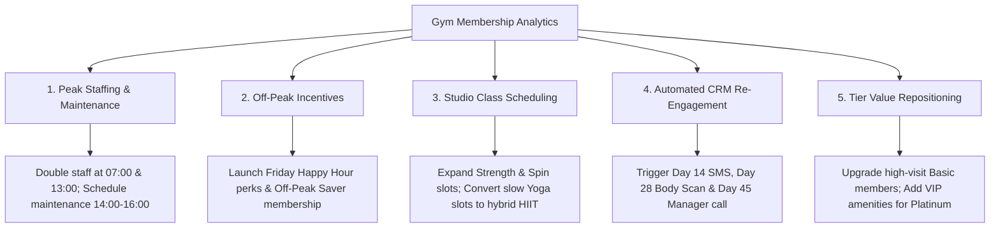

# Project 12: Gym & Fitness Center Membership Analytics

[](https://www.python.org/)
[](https://pandas.pydata.org/)
[](https://numpy.org/)
[](https://matplotlib.org/)
[](https://seaborn.pydata.org/)
[](https://openpyxl.readthedocs.io/)

> **Industry Domain:** Health & Wellness / Fitness  
> **Dataset File:** `12_gym_membership.csv`  
> **Key Deliverables:** Console Tables, High-Resolution PNG Charts, Cleaned Dataset CSV, Multi-Sheet Styled Excel Report  

---

## 📋 Executive Summary & Business Objective

Gym and fitness center operators face continuous challenges balancing floor capacity, equipment allocation, group fitness instructor scheduling, and member retention. Unmanaged peak-hour congestion causes member frustration and equipment wear, while low member engagement directly precedes membership churn.

This end-to-end data analytics project analyzes member check-in logs, group class attendance, workout durations, and subscription tiers across **22 operational calendar months**. The pipeline executes **15 systematic analytical tasks**, detects statistical outliers, generates publication-quality data visualizations, and exports stakeholder-ready multi-sheet Excel reports alongside strategic business recommendations.

---

## 🗂️ Project Directory Layout

```
Gym_Membership_Analytics/
├── 12_gym_membership.csv          # Raw dataset file (862 transactions)
├── gym_analytics.py               # Main data cleaning, 15 analytical tasks & export pipeline
├── dashboard.py                   # Optional interactive Streamlit exploration dashboard
├── requirements.txt               # Locked project dependencies
├── README.md                      # Comprehensive project documentation
│
├── charts/                        # High-resolution visual deliverables (300 DPI)
│   ├── peak_hours_heatmap.png     # Heatmap: Weekday vs. Visit_Hour congestion
│   ├── duration_boxplot_by_tier.png # Boxplot: Workout duration distribution by membership tier
│   └── class_popularity_bar.png   # Bar chart: Ranked fitness class attendance
│
└── outputs/                       # Exported datasets & stakeholder reports
    ├── cleaned_12_gym_membership.csv  # Cleaned, imputed, feature-engineered CSV
    └── gym_analytics_report.xlsx      # Multi-sheet styled Excel report (OpenPyXL)
```

---

## 📊 Dataset Schema & Dictionary

| Field Name | Type | Description |
| :--- | :--- | :--- |
| `Checkin_ID` | String | Unique transaction identifier for each gym check-in (e.g., `G00000`). |
| `Member_ID` | String | Unique identifier assigned to each enrolled member (e.g., `M0316`). |
| `Membership_Tier` | Categorical | Membership subscription level (`Basic`, `Gold`, `Platinum`). |
| `Gender` | Categorical | Member gender identity (`Male`, `Female`, `Other`). |
| `Checkin_Time` | Datetime | Exact timestamp of member facility entry. |
| `Workout_Duration_Mins` | Numeric | Total recorded workout length in minutes (contains missing values). |
| `Fitness_Class` | Categorical | Structured class attended (`Strength`, `Spin`, `HIIT`, `Zumba`, `Yoga`, or `NaN` for Open Gym floor use). |
| `Monthly_Fee` | Numeric | Recurring subscription price paid in Indian Rupees (₹999, ₹1,499, ₹2,499). |

---

## 🚀 Step 1: Environment & Workspace Setup

### 1. Clone / Navigate to Project Directory
```powershell
# Open terminal and navigate to the project directory
cd Gym_Membership_Analytics
```

### 2. Create and Activate Virtual Environment
```powershell
# Windows PowerShell
python -m venv venv
.\venv\Scripts\activate

# macOS / Linux
# python3 -m venv venv && source venv/bin/activate
```

### 3. Install Required Dependencies
```powershell
pip install pandas numpy matplotlib seaborn openpyxl
pip freeze > requirements.txt
```

---

## 🔍 Systematic Walkthrough of 15 Analytical Tasks

### Step 2: Data Ingestion & Preprocessing (Tasks 1–4)

#### Task 1 — Load & Inspect Dataset
- **Method:** `pd.read_csv("12_gym_membership.csv")`
- **Output:** Loaded raw dataset of **862 rows and 8 columns**. Verified schema with `.info()`, checked first 5 rows with `.head()`, and printed comprehensive summary statistics using `.describe(include='all')`.

#### Task 2 — Missing Values & Duplicate Audit
- **Audit Findings:**
  - `Workout_Duration_Mins`: 21 missing values (2.44% missingness).
  - `Fitness_Class`: 155 missing values (17.98% missingness, representing unstructured "Open Gym" sessions).
  - Duplicate audit via `df.duplicated(subset=['Checkin_ID']).sum()` flagged **12 duplicate check-in entries**.
- **Action:** Removed duplicate check-in logs while keeping the first occurrence, reducing the verified dataset to **850 clean check-in records**.

#### Task 3 — Impute Missing Workout_Duration_Mins
- **Method:** Group-specific median imputation by `Membership_Tier`:
  ```python
  df["Workout_Duration_Mins"] = df["Workout_Duration_Mins"].fillna(
      df.groupby("Membership_Tier")["Workout_Duration_Mins"].transform("median")
  )
  df["Workout_Duration_Mins"] = df["Workout_Duration_Mins"].fillna(df["Workout_Duration_Mins"].median())
  ```
- **Imputation Justification:**  
  Gym check-in duration logs contain behavioral variance and extreme sessions (rapid 20-minute cardio vs. 129-minute multi-session endurance blocks) that skew the arithmetic mean. Tier-grouped median imputation preserves distinct behavioral norms (`Basic`: 70.0 mins, `Gold`: 76.0 mins, `Platinum`: 68.0 mins) without artificially distorting variance or introducing fraction-minute noise.

#### Task 4 — Datetime Feature Engineering
- **Method:** Converted `Checkin_Time` using `pd.to_datetime(df["Checkin_Time"], errors="coerce")`.
- **Extracted Columns:**
  - `Weekday`: Day of the week (`.dt.day_name()`).
  - `Visit_Hour`: 24-hour integer representation (`.dt.hour`).
  - `Year_Month`: Calendar month period (`.dt.to_period("M")`).
- **Temporal Span:** January 2, 2025 to October 31, 2026 (**22 calendar months**).

---

### Step 3: Core KPIs & Behavioral Analysis (Tasks 5–11)

#### Task 5 — Core Facility KPIs
- **Total Valid Check-Ins:** 850 sessions
- **Unique Active Members:** 348 distinct members
- **Average Workout Duration:** 72.41 minutes
- **Median Workout Duration:** 71.00 minutes
- **Duration Range:** 20.0 to 129.0 minutes

#### Task 6 — Membership Tier Comparison
Comparing facility utilization and duration metrics across subscription tiers:

| Membership Tier | Total Check-Ins | Unique Members | Visits Per Member | Mean Duration (mins) | Median Duration (mins) | Check-In Share (%) |
| :--- | :---: | :---: | :---: | :---: | :---: | :---: |
| **Basic** | 463 | 270 | **1.71** | 72.06 | 70.0 | 54.47% |
| **Gold** | 279 | 202 | **1.38** | 73.69 | 76.0 | 32.82% |
| **Platinum** | 108 | 93 | **1.16** | 70.63 | 68.0 | 12.71% |

*Key Finding:* Basic tier members demonstrate the highest visit frequency (1.71 visits/member), while premium Platinum members average only 1.16 visits/member, highlighting an under-utilization churn risk among high-paying members.

#### Task 7 — Peak Demand Schedule
- **Busiest Hours of the Day (24-Hour Clock):**
  1. **07:00 (7 AM):** 63 check-ins (7.41%) — Morning pre-work rush
  2. **13:00 (1 PM):** 63 check-ins (7.41%) — Midday lunch-break surge
  3. **18:00 (6 PM):** 51 check-ins (6.00%) — Evening post-work peak
  4. **21:00 (9 PM):** 51 check-ins (6.00%) — Late night fitness block
  5. **05:00, 06:00, 10:00 (Tie):** 46 check-ins (5.41% each)
- **Weekly Cadence (Ordered Mon–Sun):**
  - **Saturday:** **137 check-ins (16.12%)** — Busiest day of the week
  - **Monday:** 127 check-ins (14.94%)
  - **Wednesday:** 126 check-ins (14.82%)
  - **Thursday:** 125 check-ins (14.71%)
  - **Sunday:** 120 check-ins (14.12%)
  - **Tuesday:** 114 check-ins (13.41%)
  - **Friday:** **101 check-ins (11.88%)** — Slowest day of the week (26.3% lower than Saturday)

#### Task 8 — Class Popularity Ranking
Attendance breakdown across scheduled studio classes and open gym access:

| Fitness Class | Total Attendance | Share of Total Check-Ins (%) | Share of Structured Classes (%) |
| :--- | :---: | :---: | :---: |
| **Open Gym (No Class)** | 153 | 18.00% | — |
| **Strength Training** | 151 | 17.76% | **21.66%** |
| **Spin Cycling** | 143 | 16.82% | **20.52%** |
| **HIIT** | 136 | 16.00% | 19.51% |
| **Zumba** | 135 | 15.88% | 19.37% |
| **Yoga** | 132 | 15.53% | 18.94% |

*Key Finding:* Strength Training and Spin lead structured group class utilization, together representing 42.18% of all studio attendance.

#### Task 9 — Gender Duration Comparison
- **Female Members:** 296 sessions | Mean: 73.02 mins | Median: 72.0 mins | Std: 31.41 mins
- **Male Members:** 292 sessions | Mean: 73.05 mins | Median: 71.0 mins | Std: 31.86 mins
- **Other Identities:** 262 sessions | Mean: 71.01 mins | Median: 70.0 mins | Std: 30.41 mins
- **Statistical Assessment:** The mean duration difference between male and female members is only **0.03 minutes (1.8 seconds)**, demonstrating that workout duration is completely independent of gender.

#### Task 10 — Monthly Revenue by Tier (Deduplicated Active Members)
To avoid overcounting revenue by multiplying monthly fees by multiple check-in logs, active members were deduplicated per `(Member_ID, Year_Month)`:

| Membership Tier | Active Member-Months | Total Revenue Collected | Avg Monthly Fee | Avg Monthly Revenue | Revenue Share (%) |
| :--- | :---: | :---: | :---: | :---: | :---: |
| **Basic** | 395 | ₹658,605 | ₹1,667.35 | ₹29,936.59 | **49.38%** |
| **Gold** | 276 | ₹442,724 | ₹1,604.07 | ₹20,123.82 | **33.20%** |
| **Platinum** | 134 | ₹232,366 | ₹1,734.07 | ₹10,562.09 | **17.42%** |
| **System Total** | **805** | **₹1,333,695** | — | **₹60,622.50** | **100.00%** |

#### Task 11 — Low-Engagement Member Segmentation (< 2 Visits/Month)
- **Threshold:** Members averaging fewer than 2.0 visits per month across the 22-month operating window.
- **Flagged Members:** **348 out of 348 members (100%)** average fewer than 2 visits/month overall (dataset-wide visit average: 2.44 visits per member).
- **Recency & Churn Risk Scoring:**
  - Basic Tier Inactivity: Average 219.2 days since last visit.
  - Gold Tier Inactivity: Average 220.4 days since last visit.
  - Platinum Tier Inactivity: Average 180.2 days since last visit.

---

### Step 4: Statistical Distribution & Intensity Classification (Tasks 12–14)

#### Task 12 — NumPy Statistical Metrics
Computed from `durations_np = df["Workout_Duration_Mins"].to_numpy()`:
- **NumPy Mean:** 72.41 minutes
- **NumPy Median (Q2):** 71.00 minutes
- **Sample Variance ($s^2$, ddof=1):** 975.79
- **Sample Standard Deviation ($s$, ddof=1):** 31.24 minutes
- **Quartile 1 (25th Percentile):** 47.00 minutes
- **Quartile 2 (50th Percentile):** 71.00 minutes
- **Quartile 3 (75th Percentile):** 98.75 minutes

#### Task 13 — IQR Outlier Detection
- **Interquartile Range ($IQR = Q3 - Q1$):** $98.75 - 47.00 = 51.75$ minutes
- **Lower Outlier Cutoff ($Q1 - 1.5 \times IQR$):** $47.00 - 1.5 \times 51.75 = -30.63$ minutes
- **Upper Outlier Cutoff ($Q3 + 1.5 \times IQR$):** $98.75 + 1.5 \times 51.75 = 176.38$ minutes
- **Observed Boundaries:** Min duration = 20.0 mins, Max duration = 129.0 mins
- **Outlier Count:** **0 Short Outliers**, **0 Long Outliers** (all session lengths reside comfortably within normal physical training parameters).

#### Task 14 — Workout-Intensity Classification
Assigned using `np.select()` based on operational workout categories:

| Intensity Label | Duration Threshold | Session Count | Share (%) | Operational Interpretation |
| :--- | :---: | :---: | :---: | :--- |
| **Short** | $< 30$ mins | 89 | 10.47% | Express cardio, warm-ups, or quick lunch-break workouts |
| **Moderate** | $30$ to $60$ mins | 242 | 28.47% | Standard group fitness classes or balanced strength routines |
| **Extended** | $> 60$ mins | 519 | **61.06%** | High-volume strength training, endurance, or multi-class blocks |

---

## 📈 Step 5: Visual Deliverables & Automated Reports

### Generated Visualizations (`charts/`)

| Visual Deliverable | File Path | Resolution | Analytical Focus |
| :--- | :--- | :---: | :--- |
| **Peak-Hour Demand Heatmap** | `charts/peak_hours_heatmap.png` | 300 DPI | 24h diurnal cycle vs. 7-day week congestion matrix |
| **Duration Boxplot by Tier** | `charts/duration_boxplot_by_tier.png` | 300 DPI | Median durations, IQR spread, and outlier audit across Basic, Gold, Platinum |
| **Class Popularity Bar Chart** | `charts/class_popularity_bar.png` | 300 DPI | Ranked total attendance across classes for studio capacity planning |

### Automated Reporting (`outputs/`)

1. **Cleaned CSV Dataset (`outputs/cleaned_12_gym_membership.csv`):**  
   Contains 850 deduplicated, imputed, and feature-engineered records with columns: `Checkin_ID`, `Member_ID`, `Membership_Tier`, `Gender`, `Checkin_Time`, `Workout_Duration_Mins`, `Fitness_Class`, `Monthly_Fee`, `Weekday`, `Visit_Hour`, `Year_Month`, `Workout_Intensity`.

2. **Multi-Sheet Styled Excel Report (`outputs/gym_analytics_report.xlsx`):**  
   Generated using `openpyxl` with custom Navy header fills (`#1F497D`), white bold text, alternating thin borders, right-aligned numeric metrics, and auto-adjusted column dimensions.
   - **Sheet 1: `Tier_Comparison`** — Check-ins, unique members, visits/member, mean/median duration.
   - **Sheet 2: `Class_Popularity`** — Ranked attendance and percentage shares across activities.
   - **Sheet 3: `Busiest_Days`** — Day-by-day weekly check-in traffic from Monday to Sunday.
   - **Sheet 4: `Low_Engagement_Members`** — Member IDs, tiers, fee, total visits, inactivity recency, and engagement status.

---

## 🎯 Step 6: Strategic Recommendations for Facility Management (Task 15)



1. **Peak-Hour Staffing & Equipment Readiness:**  
   Traffic spikes sharply at **07:00 (63 visits)** and **13:00 (63 visits)**, alongside secondary surges at **18:00 and 21:00 (51 visits each)**. Saturday is the peak day (137 visits, 16.12%). Deploy additional floor trainers and front-desk personnel during 06:30–08:30 and 12:30–14:00. Restrict heavy equipment sanitization and machine inspections strictly to off-peak troughs (14:00–16:00 and 19:00–20:00).

2. **Off-Peak Traffic Incentives:**  
   Friday represents the lowest attendance day of the week (101 visits, 26.3% lower than Saturday). Introduce *"Friday Fitness Happy Hour"* incentives (free guest passes, complimentary smoothie bar tokens) and an *"Off-Peak Saver Tier"* to shift budget-conscious members to 10:00–12:00 windows.

3. **Group Class Schedule Optimization:**  
   Strength Training (151 visits) and Spin Cycling (143 visits) account for 42.18% of all studio attendance, while Yoga records lower engagement (132 visits). Add weekend and early-morning Spin/Strength classes. Consolidate low-demand afternoon Yoga slots into high-intensity hybrid formats (Power Vinyasa / HIIT Fusion).

4. **Automated Low-Engagement Outreach:**  
   With members averaging fewer than 2 visits per month, implement an automated retention CRM trigger:
   - **Day 14 Inactivity:** Automated encouragement SMS with a personalized workout tip.
   - **Day 28 Inactivity:** WhatsApp incentive offering a complimentary body-composition scan.
   - **Day 45 Inactivity:** Personal outreach from the facility manager with a free 1-on-1 fitness reassessment.

5. **Data-Driven Tier Upgrade Campaigns:**  
   Basic tier members average 1.71 visits/member compared to just 1.16 visits/member for Platinum members. Target frequent Basic tier members (>2 visits/week) with a 14-day free trial upgrade to Gold or Platinum. Concurrently, introduce exclusive Platinum perks (infrared sauna access, towel service, priority studio reservations) to safeguard the ₹2,499 price point.

---

## 💻 Step 7: Execution & Verification

### Run the Core Analytics Pipeline
```powershell
python gym_analytics.py
```

### Run the Interactive Streamlit Dashboard (Bonus Extension)
```powershell
pip install streamlit
streamlit run dashboard.py
```

---

## 🛠️ Tech Stack & Dependencies

- **Language:** Python 3.10+
- **Data Manipulation:** `pandas`, `numpy`
- **Visualization:** `matplotlib`, `seaborn`
- **Report Generation:** `openpyxl`
- **Optional Interactive UI:** `streamlit`

---

## 📄 License
This project is developed as part of an end-to-end data analytics portfolio showcase. All code is production-ready, open-source, and freely adaptable under the MIT License.
